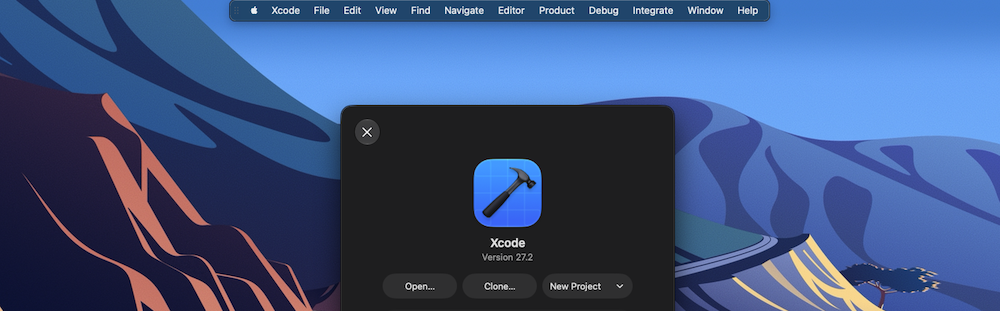
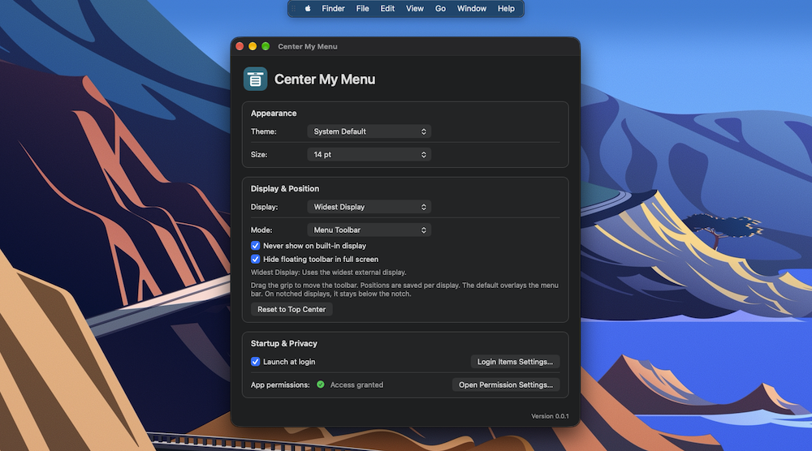

# Center My Menu

Ultra-wide displays? Very pretty. Left-justified menus on an ultra-wide display? Ugh.

**Center My Menu** is a macOS utility that displays the active app’s menus near the top center of your display. You're also free to move the menu anywhere you'd like. Enable it on all displays, on only the widest display, or have it follow the active display.



I was reminded that I've wanted something like this for ages when I came across this talk: [Scott Jenson: Are we really going to use the same Desktop UX forever?
](https://youtu.be/V7AfAcQwLW0)

> A human wrote this README.md. The code is vibed. The human wanted to create a quick little utility to fix a usability problem one afternoon. Claude and Codex spent hours robot-collaborating back and forth while working on it. It seems to work well, so here we are.

First, in order to allow an app to recreate all menus, you must grant that app **Device Control and Data Access** in macOS (called Accessibility in earlier versions).

To quote macOS Golden Gate, **"Apps with this access can view and send email, edit contacts and photos, monitor your keyboard, track websites, record your screen, control any app on your Mac, and more."** This makes me nervous. I'd rather compile from source I can inspect myself.

The goal here was to create a bare bones app that provides a toolbar version of my macOS menu with a handful of options to fit my needs. No networking code, no third-party libraries.

## Supported macOS versions

I have only tested this on macOS Golden Gate 27.2.1 and I have only built this with Xcode 27.2, but the macOS deployment target for this Xcode project is configured for macOS 14 and higher.

This project is configured for ad-hoc signing. No Apple Developer account is required.

## Download a prebuilt app

If you'd rather skip Xcode, prebuilt releases are available on the [Releases page](https://github.com/skylarstein/center-my-menu/releases). Download `Center-My-Menu.zip`, unzip it, and move `Center My Menu.app` wherever you'd like.

> The irony is not lost on me that I am providing a prebuilt app given my concerns about the macOS permissions it requires. That said, GitHub builds these releases directly from this repo and provides a way to verify which commit each download came from. You're still welcome to inspect the source and build it yourself.

To verify a download with the [GitHub CLI](https://cli.github.com/):

```sh
gh attestation verify Center-My-Menu.zip \
  --repo skylarstein/center-my-menu \
  --signer-workflow skylarstein/center-my-menu/.github/workflows/release.yml
```

The release notes include a command that also checks the exact source commit. Each release also includes `SHA256SUMS.txt` for checking the download's checksum.

The downloaded app is ad-hoc signed, not notarized by Apple, so macOS may block it from opening. GitHub's build verification does not change that. Once it opens, follow [First run and permissions](#first-run-and-permissions) below.

## Build and run

If you have never installed Xcode, install it and open it once to complete setup.

### Build from the command line

1. From the center-my-menu project directory, run `./scripts/build.sh`
2. You can find the app here: `./build/xcode/Release/Center My Menu.app`

### Build within Xcode

1. Open `CenterMyMenu.xcodeproj`.
2. Confirm the **CenterMyMenu** scheme and **My Mac** are selected.
3. Product -> Build (**⌘B**) to build. The project is pre-configured to build Release.
4. You can find the app inside the project folder: `./build/xcode/Release/Center My Menu.app`


If you're happy with the `./build/xcode/Release/Center My Menu.app` location, leave it there. Otherwise move `Center My Menu.app` to your preferred location.

## First run and permissions

1. Double-click `Center My Menu.app`
2. Select "Grant access..." from the `Center My Menu.app` menu bar icon, or from the menu toolbar itself. The floating menu toolbar will say "Permission required" at first launch.

If access stops working after moving or rebuilding the app, remove its old entry from **Device Control and Data Access** (**Accessibility** on earlier macOS versions) and add the app again.

Visit the settings menu from the `Center My Menu.app` menu bar icon for options.



Enjoy!
